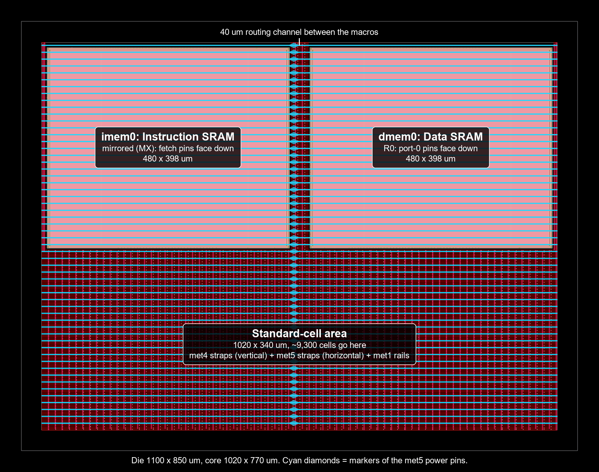
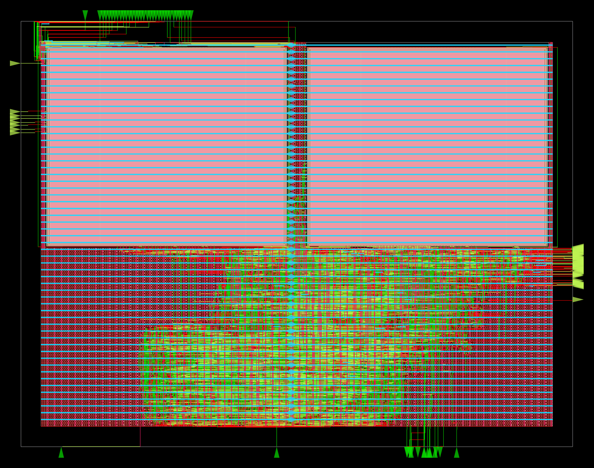
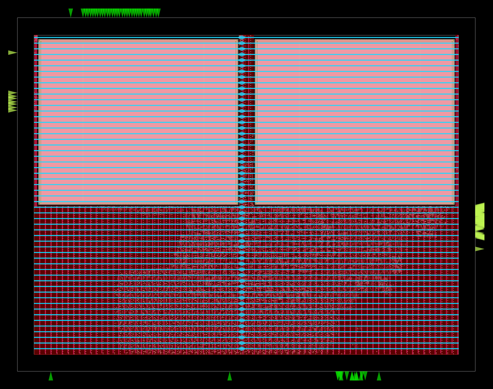

# MiniSoC: RV32I SoC, RTL-to-GDSII

A 5-stage pipelined RV32I SoC (core + AXI-Lite interconnect + GPIO/timer/UART),
verified with a UVM environment, prototyped on FPGA, and being taken through a
full open-source ASIC flow (Yosys + OpenROAD on SKY130) with a focus on
physical design: floorplanning with SRAM macros, timing closure, CTS, power
grid / IR drop, and signoff.

## Design

| Block | Contents |
|---|---|
| Core (`rtl/core`) | IF/ID/EX/MEM/WB pipeline, ALU, decoder/control, immediate gen, 32x32 register file, forwarding (bypass) unit, load-use hazard detection, branch unit + branch prediction, load/store units |
| Interconnect (`rtl/soc`) | Core-side AXI-Lite manager, AXI-Lite to simple-bus bridge with address decode |
| Peripherals (`rtl/periph`) | GPIO (32 in / 32 out), timer with IRQ, UART |
| Memories (`rtl/mem`) | 256x32 instruction and data memories built on a synchronous 1rw1r SRAM model; direct-mapped D-cache + backing RAM (not yet integrated) |

### Memories

Both memories use `sram_32x256_1rw1r`. In the ASIC flow (`USE_SRAM_MACRO`)
it wraps the OpenRAM `sky130_sram_1kbyte_1rw1r_32x256_8` hard macro
(`macros/`); in simulation it is a behavioral model with the macro's ports
and cycle timing: active-low chip select and write enable, registered
address, and read data valid only in the cycle after a read. The macro drives
its output to X after every clock edge that is not a read, and the model
does the same, so nothing can rely on read data holding.

- **Instruction memory** sits in `rv32i_soc`, outside the core. The core drives
  `imem_addr` with the *next* PC, so the SRAM's registered output always
  matches the current `pc_out`. That keeps fetch cycle-for-cycle identical to
  the original combinational ROM. Port 1 serves fetch, and port 0 is a
  program-load port (`imem_load_we/addr/data`) used while reset is held.
- **Data memory** sits behind the AXI-Lite bridge. The bridge keeps the SRAM
  selected with a stable address from `R_ACCESS` through `R_RESP`, so the SRAM
  re-reads each cycle until the manager accepts the data. (Selecting it only
  in `R_ACCESS` worked with a hold-forever model but returned X with the
  macro's real behavior; the macro-accurate model caught it.)

Memory map (from `axi_lite_to_simple_bus.v`):

| Region | Address |
|---|---|
| Data memory | `0x0000_0000` - `0x0FFF_FFFF` |
| GPIO | `0x1000_0xxx` |
| UART | `0x1000_1xxx` |
| Timer | `0x1000_2xxx` |

## Repository layout

```
rtl/            synthesizable RTL (rtl.f = filelist, include/ = Def.v)
tb/uvm/         UVM env, interfaces, SVA, coverage (uvm.f = filelist)
tb/directed/    directed unit/system testbenches
sw/             RV32I encoder + hazard-aware random program generator
sw/programs/    program images loaded via +PROGRAM=<file>.hex
fpga/           FPGA-only wrapper, XDC, and Vivado implementation reports
flow/           ASIC flow: ORFS config.mk, constraint.sdc, pdn.tcl,
                macro_placement.tcl, run.sh, save_images.tcl
macros/         SKY130 SRAM macro (LEF, LIB, GDS, Verilog), Apache-2.0
docs/images/    layout images
scripts/vivado/ recreate the Vivado project / run UVM tests in batch
```

## Running the ASIC flow (OpenROAD-flow-scripts, sky130hd)

Needs WSL2 (or Linux) with Docker and the `openroad/orfs` image
(`docker pull openroad/orfs:latest`). From WSL:

```
flow/run.sh synth            # Yosys synthesis
flow/run.sh floorplan        # any ORFS stage: floorplan place cts route finish
flow/run.sh gui_floorplan    # open a finished stage in the OpenROAD GUI
flow/run.sh images floorplan # save PNGs of a finished stage (headless)
```

The repo is mounted read-only; outputs go to `~/rv32i_orfs_work`
(`logs/`, `reports/`, `results/` under `sky130hd/rv32i_soc/base`). The RTL
list comes from `rtl/rtl.f`, shared with simulation.

## Running simulation (Vivado xsim)

From the repo root:

```
vivado -mode batch -source scripts/vivado/run_uvm.tcl -tclargs random_program_test program_random.hex
```

Available tests: `hello_test`, `basic_program_test`, `random_program_test`.
Directed testbenches (set as the sim top): `tb_rv32i_soc` (full-SoC program
plus GPIO/timer/UART checks) and `tb_imem_load` (program-load port, checked
against a preloaded SoC in lockstep). `tb_rv32i_core` has one known failing
check (x17) that predates this repo. `tb_cache` targets an older SoC with the
D-cache integrated and doesn't elaborate against the current top.
To open the project in the GUI instead, run `scripts/vivado/create_project.tcl`
and open `build/vivado/MiniSoC.xpr`.

New random programs:

```
python sw/program_gen.py <seed> sw/programs/program_random.hex
```

## Results so far

FPGA (Vivado 2024.2, xczu7ev-2, routed): 100 MHz constraint met with
WNS +5.04 ns, WHS +0.04 ns; ~2.0k LUTs, ~1.9k FFs. Reports in `fpga/reports/`.

### Synthesis, sky130hd (Yosys 0.68 via ORFS, 20 ns clock)

| Metric | Value |
|---|---|
| Standard cells | 9,347 |
| Logic area | 109,470 µm² (0.109 mm²) |
| SRAM macros | 2 × 190,713 µm² (381,425 µm²) |
| Total cell area | 490,894 µm² |
| Sequential share of logic area | 50.4% |
| Flip-flops | 1,979 (1,329 enable, 441 async-reset, 209 other) |
| Latches / check problems | 0 / 0 |

Area by block, from an earlier hierarchical run with the SRAMs as black boxes
(no cross-boundary optimization, so it totals about 129,090 µm² rather than
the flat ~109,300 µm²):

| Block | Area (µm²) | Share |
|---|---|---|
| Register file (32×32 flops + 2 read muxes) | 55,570 | 43% |
| AXI-Lite manager + bridge | 14,390 | 11% |
| ALU | 8,660 | 7% |
| Pipeline registers (ID/EX, EX/MEM, MEM/WB) | 17,990 | 14% |
| Program counter + JALR adder | 8,115 | 6% |
| Peripherals (GPIO, timer, UART) | 10,330 | 8% |
| Everything else (decode, control, forwarding, ...) | 14,030 | 11% |

The register file dominates. That makes it the first PPA target: dropping
its reset, or replacing the flops with a latch-based array or a register-file
macro.

### Floorplan



| Item | Value |
|---|---|
| Die / core | 1100 × 850 µm / 1020 × 770 µm |
| Utilization (cells + macros over core) | 63% |
| Macro placement | Manual (`flow/macro_placement.tcl`), 20 µm halos, 40 µm channel |
| Standard-cell band | 1020 × 340 µm under the macros |
| Tap cells | 5,006 |
| Pre-placement worst slack | +8.78 ns at 20 ns (an I/O path from `reset`) |

Both SRAMs sit along the top edge. Port-1 pins are on the macro's top and
right edges and port-0 pins on its bottom and left, so the instruction SRAM
is mirrored (MX) to turn its fetch port toward the logic, and the data SRAM
(port 0 only) stays at R0. The automatic macro placer could not fit its
80 µm minimum channels in this core, which is why placement is manual.

The power grid is the sky130hd platform grid (met1 rails, met4/met5 straps)
plus connections for the macros' `vccd1`/`vssd1` pins (`flow/pdn.tcl`).
Open items: only 6 of 106 macro pins align to the routing tracks (to check
at routing), and one met4-to-met5 via was skipped near (42, 394) µm.

### Baseline run to GDS (place, CTS, route, finish)



The baseline flow runs with default ORFS settings and closes timing at
20 ns with no DRC or antenna violations. The final layout is
`~/rv32i_orfs_work/results/sky130hd/rv32i_soc/base/6_final.gds` (26 MB, not
committed; standard cells and
SRAM layout merged by KLayout with no missing or orphan cells).

| Metric | Value |
|---|---|
| Clock target | 20 ns (50 MHz) |
| Setup WNS / TNS | +8.19 ns / 0 |
| Hold worst slack / TNS | +0.12 ns / 0 |
| Minimum clock period | 11.81 ns (84.6 MHz) |
| Clock skew (setup / hold) | 0.58 / 0.52 ns |
| Standard cells (no fill) | 14,600: 5,006 taps, 536 timing-repair buffers, 363 clock buffers/inverters, 39 antenna diodes |
| Area | 124,170 µm² standard cells + 381,425 µm² macros = 505,595 µm² |
| Utilization | 64.6% of the core (standard cells alone: 31%) |
| Power (TT, vectorless) | 13.4 mW: sequential 34%, clock tree 30%, SRAMs 29%, combinational 7% |
| Wirelength / vias | 480,323 µm / 84,048 (met1 41%, met2 39%, met3 16%, met4 4%) |
| Global route overflow | 0 (16% of routing resources used) |
| Detailed-route DRC | 0 (13,571 at the first iteration) |
| Antenna violations | 0 (22 diodes inserted) |
| Max-slew violations | 28, all on SRAM input pins (see below) |
| Runtime | ~15 min on 12 threads, 13 min of it detailed routing |

Timing here uses the router's parasitic estimates. Extracted RC,
multi-corner STA and KLayout/Magic DRC/LVS come in signoff.

**Critical path.** The worst register-to-register path is the predicted one:
register-file read, branch compare, next-PC select, instruction SRAM address
(`imem0 addr1[2]`).

| Segment | Delay (ns) | Arrives at (ns) |
|---|---|---|
| Clock tree to the launch flop | 1.01 | 1.01 |
| Flop clk-to-Q plus four `buf_4` stages fanning the register-file read select out (fanout 31-41 each) | 3.38 | 4.39 |
| Register-file read (two levels of `mux4`) | 1.13 | 5.52 |
| Branch compare and taken decision | 3.13 | 8.65 |
| Next-PC select | 1.81 | 10.46 |
| Wire repeaters to the SRAM pin, including three `clkdlybuf4s50` delay cells | 1.75 | 12.21 |
| Required time at the SRAM (clock latency 0.75, uncertainty, setup) | | 20.39 |

Two things stand out for timing closure: about 3.4 ns goes into fanning out
the register-file read select, and the resizer used slow delay cells as wire
repeaters (about 1.45 ns of the last segment).

**SRAM slew waiver.** The OpenRAM Liberty file characterizes the SRAM inputs
only up to a 40 ps input slew and sets that as the pins' `max_transition`.
No sky130hd driver can meet 40 ps at an SRAM pin, so all 28 SRAM address and
write-mask pins report violations, most of them by 1-15 ps. The worst are the
fetch address pins `addr1[4:7]` at about 0.3 ns. The SRAM setup and hold
times beyond 40 ps are extrapolated from the table, so this is recorded as a
known limitation of the macro's characterization, not fixed.

**Floorplan open items, resolved:** the router reached every SRAM pin with
no pin-access errors, despite only 6 of 106 pins sitting on routing tracks.
The skipped power via is still to check in the IR-drop analysis.



## Roadmap

- [x] RTL + UVM verification + FPGA implementation
- [x] Repository setup
- [x] ASIC-ready RTL: synchronous SRAMs for instruction and data memory, program-load port, synthesis cleanups
- [x] SDC constraints
- [x] Yosys synthesis on sky130hd
- [x] sky130 SRAM macros integrated (LEF/LIB/GDS), floorplan + power grid
- [x] Baseline OpenROAD run to GDS (place, CTS, route, finish)
- [ ] Timing closure: push frequency, physical vs. RTL fixes
- [ ] PPA experiments: utilization, aspect ratio, macro placement, CTS, PDN
- [ ] Signoff: RC extraction, multi-corner STA, IR drop, DRC/LVS, antenna
